# RIDZ GSD Playbook — Safe Feature Development

A rigorous methodology for using AI agents to ship features with minimal vulnerabilities, zero missed edge cases, and high performance.

## The One Rule
**AI produces bugs where requirements are implicit.**
Every feature must be specified as testable invariants (things that must always or never be true), each paired with an explicit enforcement point and an automated test. Reviews evaluate code strictly against this invariant list and threat model — never unbounded speculation.

---

## 1. Risk Tiering & Path Selection

| Risk Tier | Examples | Path / Depth | Mode & Settings |
| :--- | :--- | :--- | :--- |
| **Trivial** | Typo, static copy, config value, rename | Quick edit | Any mode |
| **Low** | Read-only listing, UI visual tweak, presentation-only component | Full loop, standard review | YOLO OK |
| **Medium** | New CRUD resource, notifications, search, admin views, data caching | Full loop + plan review | Interactive, deep review |
| **High** | Auth, roles/permissions, payments/credits, telemetry tamper checks, agent decommission, PII, file upload, webhooks, data migration | Full loop + plan review convergence | Interactive, deep review, block_on: medium |

**Rule of Thumb:** If a bug could leak tenant data, bypass authentication/RBAC, compromise agent security, corrupt telemetry, or let one user act as another — it is **High tier: NO SHORTCUTS**.

---

## 2. Invariant Checklists by Feature Type

Before writing code, extract and paste only the applicable invariant checklists into the phase spec. Do not leave the agent to guess.

### A. Authentication & Sessions
- Tokens: Short-lived access tokens, secure storage, immediate revocation on logout.
- 401 response handling: Clear stored credentials and redirect cleanly without cascading loops.
- Password/login/reset endpoints rate-limited per account and IP; lockout/backoff enforced.
- Login/reset responses must not leak account existence.
- Deactivated or deleted accounts rejected on every authenticated call.

### B. Authorization & Scoping (Most Common Bug Class)
- Every endpoint/mutation taking an ID verifies caller ownership and role server-side (no IDOR).
- Role/permission scope enforced in a shared guard/policy/dependency, never ad-hoc scattered `if` statements.
- Client-sent `role`, `owner_id`, `company_slug`, `status`, or `is_admin` fields are strictly ignored or forbidden (`extra="forbid"` / Zod strict).
- List queries filter by caller's tenant/scope in the database query, never by fetching all and filtering in memory.
- Administrative and security actions (e.g. agent decommission, token generation, role assignment) produce immutable audit records.
- **Test:** User A attempts every endpoint with User B's identifiers $\to$ 403 Forbidden / 404 Not Found.

### C. Concurrency & State Integrity
- Limit and state checks enforced atomically (e.g., atomic `UPDATE ... WHERE`, conditional writes, or DB transactions).
- Never do "read $\to$ check in app code $\to$ write" for concurrent resources.
- Uniqueness enforced by unique / partial unique database indexes.
- Status fields are strict state machines: explicit valid transitions; illegal transitions rejected.
- Optimistic locking guarded by `WHERE status = <expected_status>`.

### D. Input Validation & Data Contracts
- Strict runtime schemas (Zod / Pydantic / TypeScript types) validating string bounds, numeric ranges, regex formats, and enums. Extra fields rejected on write operations.
- Parameterized queries / ORM only — zero raw concatenated query strings.
- API response serializers explicitly allowlist returned fields; never leak internal credentials, hashed secrets, database IDs, or sensitive telemetry.
- Soft-deleted records respected in queries where applicable.

### E. External Integrations & Webhooks
- Inbound webhooks: Verify signature and timestamp tolerance; deduplicate by unique provider event ID; respond fast and process async.
- Outbound calls: Set strict timeouts; retry with exponential backoff only for idempotent operations.
- Never invoke external network calls inside database transactions or while holding locks.
- Provider downtime leaves the system in a known, recoverable state (e.g. pending).

### F. Performance & Resource Boundaries
- Database indexes for every filtered, sorted, or joined column on hot paths.
- No N+1 queries: Eagerly load or batch-fetch related entities.
- All listing endpoints paginated with bounded `limit` and `cursor`/`offset`.
- No unbounded queries (never `.all()` or `SELECT *` without limit on tables that grow).

---

## 3. The 9-Phase Per-Feature Loop

```mermaid
flowchart LR
    Spec[1. Spec & Invariants] --> Discuss[2. Discuss Gray Areas]
    Discuss --> Plan[3. Plan Enforcement & Tests]
    Plan --> Execute[4. TDD Execute Red->Green]
    Execute --> Review[5. Bounded Code Review]
    Review --> Secure[6. Threat Model ASVS Check]
    Secure --> Validate[7. Invariant Test Coverage]
    Validate --> Verify[8. Real Flow UAT]
    Verify --> Learn[9. Learn & Ship]
```

1. **Spec Phase (`/gsd-spec-phase N`)**:
   - Write every requirement as a numbered invariant: `INV-1`, `INV-2`, etc.
   - Specify caller roles, limits (sizes, rates, pagination), and explicit out-of-scope items.
   - Pull the applicable checklists above. Flag ambiguities instead of assuming.
2. **Discuss Phase (`/gsd-discuss-phase N`)**:
   - Resolve partial failure behaviors, idempotency, edge cases, concurrent requests, and permission edge cases.
   - Record explicit decisions as `D-01`, `D-02`, etc. Never discard decision markers.
3. **Plan Phase (`/gsd-plan-phase N`)**:
   - For every `INV-x`: identify the exact enforcement point (DB constraint, middleware, route guard, service validator) and the test that proves it.
   - Target 3–6 files per phase. Wave 1 = failing tests for every High-risk invariant.
4. **Execute Phase (`/gsd-execute-phase N`)**:
   - TDD Mode: Write failing tests first (RED), then implement minimal code to pass (GREEN).
   - Follow existing patterns in `src/lib`, `src/services`, `src/components`.
5. **Code Review Phase (`/gsd-code-review N`)**:
   - Bounded review: Evaluate ONLY against this phase's invariants (`INV-x`), decisions (`D-xx`), and threat model.
   - Every finding must contain: `file:line`, concrete failure scenario (input $\to$ bad outcome), severity. No stylistic nits. Max 15 findings.
6. **Security Phase (`/gsd-secure-phase N`)**:
   - Verify all threat mitigations exist (ASVS Level 2, no IDOR, safe headers, authenticated endpoints). Must return `SECURED`.
7. **Validation Phase (`/gsd-validate-phase N`)**:
   - Verify 100% of invariants have passing automated test coverage.
8. **Verify Work (`/gsd-verify-work N`)**:
   - Perform end-to-end UAT verification (including double-submit, unauthorized caller, invalid input).
9. **Extract Learnings (`/gsd-extract-learnings N`)**:
   - Document edge-case patterns and learnings to prevent bug repetition in future phases.

---

## 4. Anti-Patterns to Reject

- "Check if exists, then insert" without unique constraint or atomic upsert.
- "Fetch count, compare to limit, then create" without atomic transaction/lock.
- Trusting any client-supplied role, price, tenant slug, or user ID.
- Performing external API / email calls inside an open database transaction.
- "We'll add tests later" or testing only the happy path.
- Unpaginated listings or unbounded client-side fetches.
- Catch-all empty error handlers (`catch (e) {}` / `except Exception: pass`).
